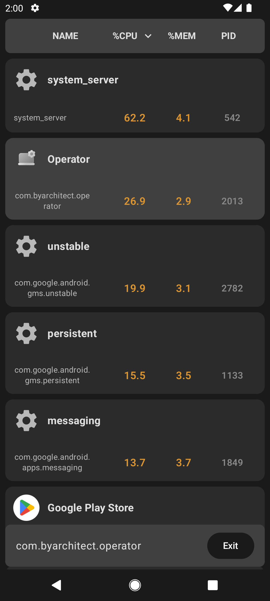
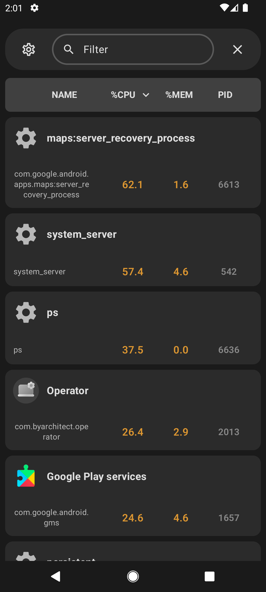

<div align="center">


# Operator

**A process manager for Android, with root or Shizuku.**
See what's running, what it's costing you, and stop it.

[](https://f-droid.org/packages/com.byarchitect.operator/)
[](https://apt.izzysoft.de/packages/com.byarchitect.operator)
[](https://github.com/by-architect/Operator/releases)
[](#-requirements)
[](Lisence.md)


&nbsp;&nbsp;


</div>

---

## ✨ What it does

Android hides what your device is actually doing. Operator uses root to read the
process table directly, so you get the real picture — and the ability to act on it.

- 📊 **Live process list** — refreshes on your schedule, not the system's
- ⚡ **CPU and memory per process** — find what's draining the battery
- 🔪 **Stop what you don't want** — kill processes with root, or force-stop apps over Shizuku
- 🔎 **Search and sort** — by name, PID, CPU or memory, ascending or descending
- 🧩 **58 selectable columns** — PID, PPID, VSZ, RSS, WCHAN, NI, ARGS and the rest of `ps`
- ⏱️ **Adjustable refresh rate** — trade responsiveness against battery
- 🌑 **Dark, dense, no clutter** — Material 3, built for reading tables

## 📋 Requirements

| | |
|---|---|
| **Android** | 7.0 (API 24) or newer |
| **Access** | Root (Magisk, KernelSU…) **or** [Shizuku](https://shizuku.rikka.app/) |

Operator needs privileged access to read the process table — a normal app cannot see
other processes on modern Android. It works two ways:

- **Root** — full access. Any process can be inspected and killed.
- **Shizuku** — no root needed. Commands run as the ADB shell user, which can read the
  whole process table and force-stop apps. Shizuku has to be restarted after each reboot,
  and system processes cannot be stopped this way.

Root is used automatically when available, otherwise Operator falls back to Shizuku.

## 📥 Install

[](https://f-droid.org/packages/com.byarchitect.operator/)
[](https://apt.izzysoft.de/packages/com.byarchitect.operator)
[](https://fdroid.byarchitect.org/fdroid/repo?fingerprint=50941BDAC56B056A520ABFA3FC7DAAB789DEE5B83B295DA54A1961C7BC8A91C9)
[](https://github.com/by-architect/Operator/releases/latest)

- **F-Droid**, **IzzyOnDroid** and the **ByArchitect F-Droid repository** keep Operator up to date. To add the
  ByArchitect repository, open [this link](https://fdroid.byarchitect.org/fdroid/repo?fingerprint=50941BDAC56B056A520ABFA3FC7DAAB789DEE5B83B295DA54A1961C7BC8A91C9) on your phone, then search for Operator in F-Droid.
- **GitHub:** download `operator-v<version>.apk` from the
  [latest release](https://github.com/by-architect/Operator/releases/latest). It does not update itself.

> [!IMPORTANT]
> **Coming from v1.0.0?** Uninstall it first. Every release from v1.0.1 onwards is signed
> with a new key, so Android will refuse it as an update and your settings will be lost.
> [Why](SECURITY.md#signing-key-history).

Verify what you downloaded before installing it:

```bash
apksigner verify --print-certs Operator-v1.0.1.apk
```

The expected fingerprint is in [SECURITY.md](SECURITY.md).

## 🔨 Build

```bash
git clone https://github.com/by-architect/Operator.git
cd Operator
./gradlew assembleRelease
```

Release process and signing are documented in [RELEASING.md](RELEASING.md).

## 🛠️ Built with

Kotlin · Jetpack Compose · Material 3 · Room · libsu

## 📮 Contact

**byarchitect@disroot.org** — security reports, key verification, or anything that
needs a channel other than this repository. See [SECURITY.md](SECURITY.md).

## ⚖️ License

[GNU GPL v3.0](Lisence.md) — free software. Use it, change it, share it.
